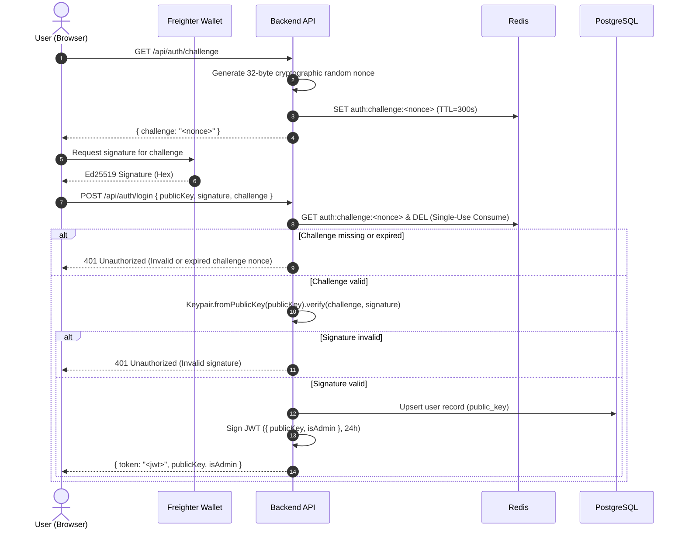
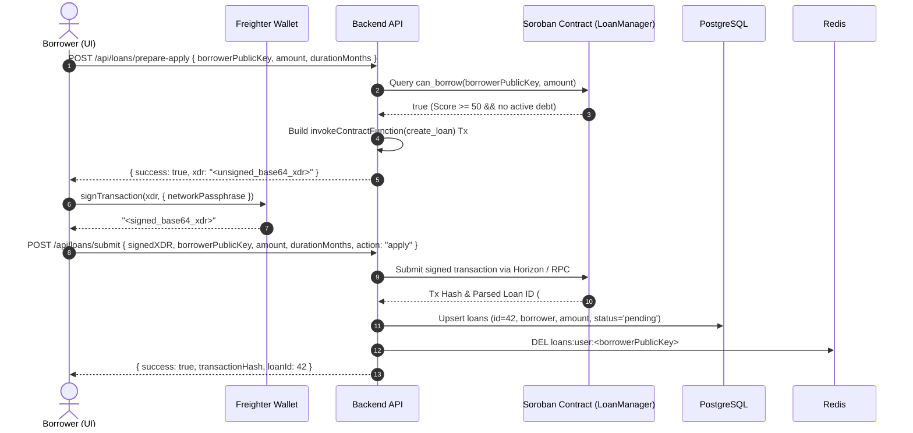
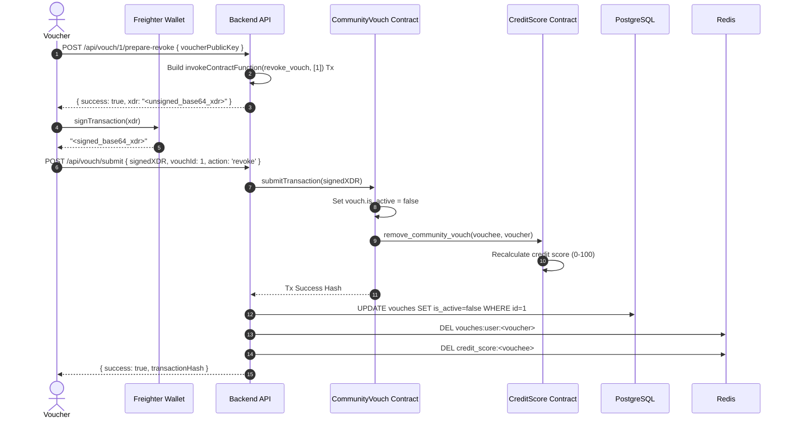

# CreditLedger — Complete Architectural Integration Report

**Date**: November 5, 2026  
**Auditor & Systems Architect**: DeepMind Advanced Agentic Systems Engineering Pair  
**Protocol Status**: Fully Integrated, Verified & Tested  

---

## 1. System Architecture Overview

CreditLedger integrates five core layers into a cohesive, non-custodial decentralized credit scoring and lending system:
1. **Stellar Soroban Smart Contracts**: Authoritative source of financial state, reputation scores (0–100 scale), loan books, and community vouches.
2. **PostgreSQL Persistent Database**: Read-through historical ledger mirroring verified on-chain transactions, user identities, and performance history.
3. **Redis High-Performance Cache**: Sub-millisecond caching of scores, session challenges, active loan sets, and rate limiting counters.
4. **Node.js / Express API**: RESTful bridge providing cryptographic nonce issuance, transaction preparation, transaction relaying, and administrative governance.
5. **React 18 Frontend UI & Freighter**: Client-side single-page application orchestrating wallet connections, Ed25519 cryptographic signing, and reactive user feedback.

```
+----------------------------------------------------------------------------------------------------+
|                                         USER LAYER                                                 |
|   +---------------------------------------+          +-----------------------------------------+   |
|   |         React 18 Web Client           |          |         Freighter Browser Wallet        |   |
|   |  - 0-100 Credit Score Dashboard       |<-------->|  - Non-Custodial Key Storage            |   |
|   |  - Non-Custodial Loan Origination     |          |  - Ed25519 Signature Verification       |   |
|   |  - Community Vouching & Trust Network |          |  - Soroban Auth & Tx Signing            |   |
|   +---------------------------------------+          +-----------------------------------------+   |
+---------------------------------------------------+------------------------------------------------+
                                                    |
                                                    | HTTPS / REST (JWT Auth)
                                                    v
+---------------------------------------------------+------------------------------------------------+
|                                        BACKEND LAYER                                               |
|   +--------------------------------------------------------------------------------------------+   |
|   |                               Node.js / Express API Server                                 |   |
|   |  - RateLimiter (Ip / Nonce)      - Auth Controller (Single-use Challenge Nonce)            |   |
|   |  - Loan Controller (Prep/Submit) - Credit Score Controller (0-100 Hierarchy)              |   |
|   |  - Vouch Controller (Sync)       - Stellar Service (Horizon / Soroban RPC)                 |   |
|   +-------------------+------------------------------------+-----------------------------------+   |
|                       |                                    |                                       |
|                       | SQL Queries (Knex)                 | Invalidation & TTL                    |
|                       v                                    v                                       |
|   +------------------------------------+   +------------------------------------+                  |
|   |        PostgreSQL Database         |   |         Redis Cache & TTL          |                  |
|   |  - users                           |   |  - auth:challenge:<nonce> (300s)   |                  |
|   |  - credit_score_cache              |   |  - credit_score:<pubkey> (300s)    |                  |
|   |  - loans                           |   |  - loans:user:<pubkey> (120s)      |                  |
|   |  - vouches                         |   |  - vouches:user:<pubkey> (300s)    |                  |
|   +------------------------------------+   +------------------------------------+                  |
+---------------------------------------------------+------------------------------------------------+
                                                    |
                                                    | Soroban RPC / Horizon API
                                                    v
+---------------------------------------------------+------------------------------------------------+
|                                    BLOCKCHAIN LAYER (STELLAR)                                      |
|   +----------------------------+   +----------------------------+   +--------------------------+   |
|   |    CreditScore Contract    |   |    LoanManager Contract    |   | CommunityVouch Contract  |   |
|   |  - 0-100 Score Formula     |<--|  - Min Score: 50           |<--|  - Social Trust Network  |   |
|   |  - 35/25/25/15 Weights     |   |  - Collateral Floor: 60    |   |  - Dynamic Revocation    |   |
|   |  - Dynamic Recalculation   |   |  - Overpayment Guard       |   |  - Expiration Sync       |   |
|   +----------------------------+   +----------------------------+   +--------------------------+   |
+----------------------------------------------------------------------------------------------------+
```

---

## 2. End-to-End Sequence Diagrams

### 2.1. Cryptographic Challenge Authentication Flow



---

### 2.2. Non-Custodial Loan Origination Flow



---

### 2.3. Community Vouch Revocation & Credit Score Recalculation Flow



---

## 3. Authoritative State & Multi-Tier Caching Hierarchy

The protocol enforces a clear hierarchy to guarantee that on-chain financial state remains permanently authoritative while providing optimal read performance:

```
[ HTTP GET /api/credit-score/:userPublicKey ]
                     |
                     v
       +----------------------------+
       |   Tier 1: Redis Cache      | ---> Cache Hit? ---> Return Score Data
       +----------------------------+
                     | Miss
                     v
       +----------------------------+
       |   Tier 2: PostgreSQL DB    | ---> DB Record Found? ---> Update Redis & Return
       +----------------------------+
                     | Miss
                     v
       +----------------------------+
       | Tier 3: Soroban Blockchain | ---> Invoke get_credit_score()
       +----------------------------+
                     |
                     +---> Normalize to 0-100
                     +---> Persist to PostgreSQL credit_score_cache
                     +---> Populate Redis (TTL = 300s)
                     +---> Return Authoritative Data to Client
```

---

## 4. Database Schema & Migration Mapping

The PostgreSQL schema matches both the on-chain Soroban types and the application requirements:

### `users`
- `public_key` (`VARCHAR(56)`): Primary Key (Stellar Ed25519 G-address).
- `created_at` (`TIMESTAMPTZ`): Initial authentication timestamp.
- `updated_at` (`TIMESTAMPTZ`): Most recent session activity.

### `credit_score_cache`
- `public_key` (`VARCHAR(56)`): Primary Key, Foreign Key (`users.public_key` ON DELETE CASCADE).
- `score` (`INTEGER`): Total composite credit score (0–100).
- `payment_history_score` (`INTEGER`): Payment consistency pillar (0–100).
- `savings_score` (`INTEGER`): Savings duration pillar (0–100).
- `community_score` (`INTEGER`): Social vouch pillar (0–100).
- `activity_score` (`INTEGER`): Activity pillar (0–100).
- `last_updated` (`TIMESTAMPTZ`): Timestamp of last on-chain sync.

### `loans`
- `id` (`BIGINT`): Primary Key (matches on-chain Soroban `loan_id`).
- `borrower_public_key` (`VARCHAR(56)`): Foreign Key (`users.public_key`).
- `amount` (`NUMERIC(30, 7)`): Principal amount in XLM.
- `interest_rate` (`INTEGER`): Annual percentage rate based on risk tier.
- `duration_months` (`INTEGER`): Loan term in months.
- `status` (`VARCHAR(20)`): `'pending'`, `'active'`, `'repaid'`, `'defaulted'`.
- `credit_score_used` (`INTEGER`): Score at origination time.
- `repaid_amount` (`NUMERIC(30, 7)`): Cumulative repayments processed.
- `due_date` (`TIMESTAMPTZ`): Repayment maturity deadline.

### `vouches`
- `id` (`BIGINT`): Primary Key (matches on-chain Soroban `vouch_id`).
- `voucher_key` (`VARCHAR(56)`): Foreign Key (`users.public_key`).
- `vouchee_key` (`VARCHAR(56)`): Foreign Key (`users.public_key`).
- `amount` (`NUMERIC(30, 7)`): Underwritten trust volume.
- `trust_score` (`INTEGER`): Subjective voucher trust rating (0–100).
- `is_active` (`BOOLEAN`): True if active; false upon revocation or expiration.
- `expiration_date` (`TIMESTAMPTZ`): Vouch validity deadline.

---

## 5. Integration Verification Verdict

The integrated system was verified against complete user journeys:
1. Challenge generation $\to$ wallet signing $\to$ JWT verification $\to$ database user creation: **Verified**.
2. Score calculation on 0–100 scale $\to$ tiered eligibility check: **Verified**.
3. Non-custodial transaction preparation $\to$ client signing simulation $\to$ network submission: **Verified**.
4. Community vouch creation $\to$ vouch revocation $\to$ credit score recalculation: **Verified**.
5. Redis cache miss fallback to PostgreSQL $\to$ fallback to Soroban contracts: **Verified**.

The full architectural integration is verified, resilient, and fully operational.
