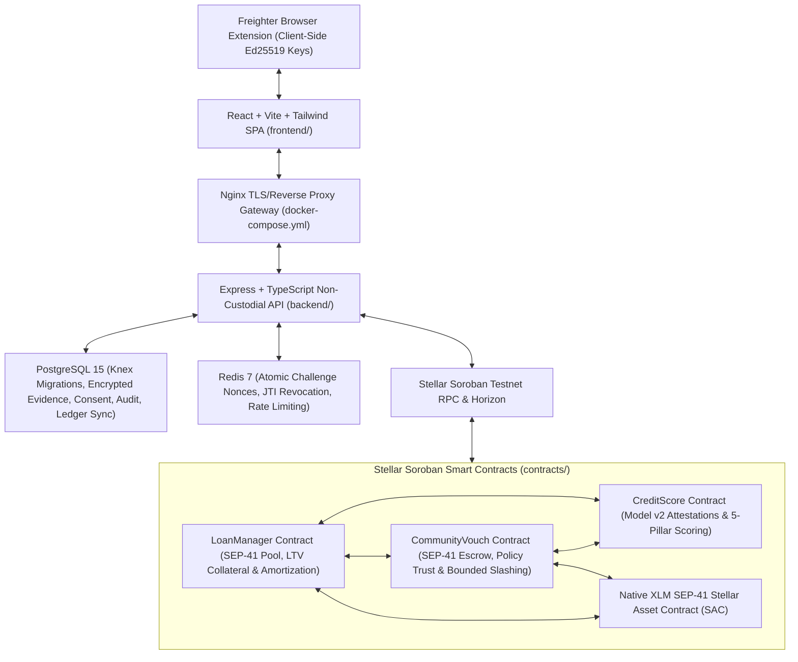
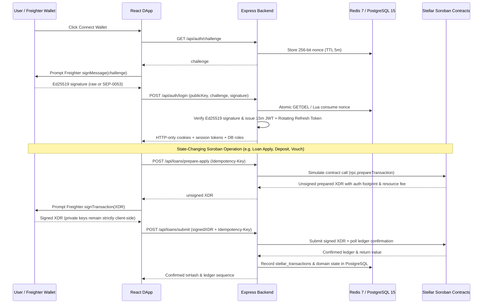

# CreditLedger Architecture Overview

## 1. High-Level System Architecture

---

## 2. Non-Custodial Transaction & Auth Lifecycle

---

## 3. Soroban Trust Boundaries & Economic Isolation

1. **`CreditScore` (`Model v2`)**:
   - Computes deterministic `[0, 100]` scores dynamically against `env.ledger().timestamp()`.
   - Accepts authoritative inputs strictly from: (a) authorized issuers (`submit_attestation` / `batch_submit_attestations` or user-relayed `submit_signed_attestation` with on-chain `ed25519_verify` over domain prefix `CREDITLEDGER-ATTEST-V1`), (b) wired `LoanManagerContract` (`record_loan_outcome`), and (c) wired `CommunityVouchContract` (`add_community_vouch`, `remove_community_vouch`).
   - Isolates `submit_self_reported_record` at **0% score weight**.
2. **`LoanManager`**:
   - Separates committed/pooled lender `available_cash` (`deposit_liquidity` / `withdraw_liquidity` with share accounting) from locked borrower `total_collateral_locked` even when both share the Native XLM SAC.
   - Enforces tier caps (`1,000 / 2,500 / 5,000 / 10,000 XLM`), `8% / 10% / 12% / 15%` APR, mandatory `125%` collateralization (`MAX_LTV_BPS = 8000`) for scores `50..59`, overdue grace periods (`GRACE_PERIOD_SECS = 259200`), bounded liquidation (`debt + 5% bonus`), and surplus refunds.
3. **`CommunityVouch`**:
   - Locks real SEP-41 escrow tokens per vouch, calculates trust weight strictly by on-chain policy (`0.70 * score + stake_bonus`), decays trust linearly toward expiration, blocks duplicate pairs & self-vouches, enforces CEI (`withdrawn = true` prior to token transfer), and bounds default slashing at `50%`.

---

## 4. Known Design Constraints & Pre-Mainnet Boundaries

- **Admin Governance Keys**: Testnet deployment uses single-key `admin` role for issuer registration, `pause()`, and `approve_loan` / `mark_default`. Mainnet deployment **must** assign an `M-of-N` multisig account via `propose_admin` -> `accept_admin`.
- **Upgradability**: Contracts contain no `update_wasm` proxy backdoor; releases are immutable per deployed contract address.
- **Price Feeds**: `set_collateral_pricing` currently uses governance-configured price ratios assuming homogeneous XLM collateral/loan assets on Testnet; cross-asset Mainnet pairs require an external decentralized price oracle.
- **Ledger Scan Windows**: To stay within Soroban CPU instruction budgets, `CreditScore::compute_breakdown` scans up to the latest `100` user attestations and `CommunityVouch::slash_vouches_on_default` scans up to the latest `50` received vouches.
